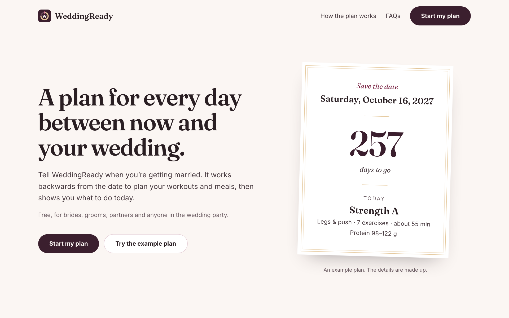
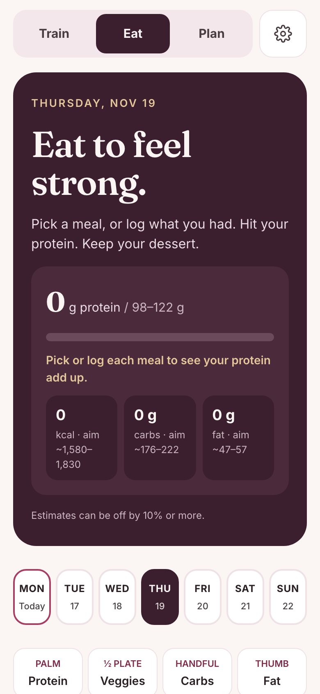
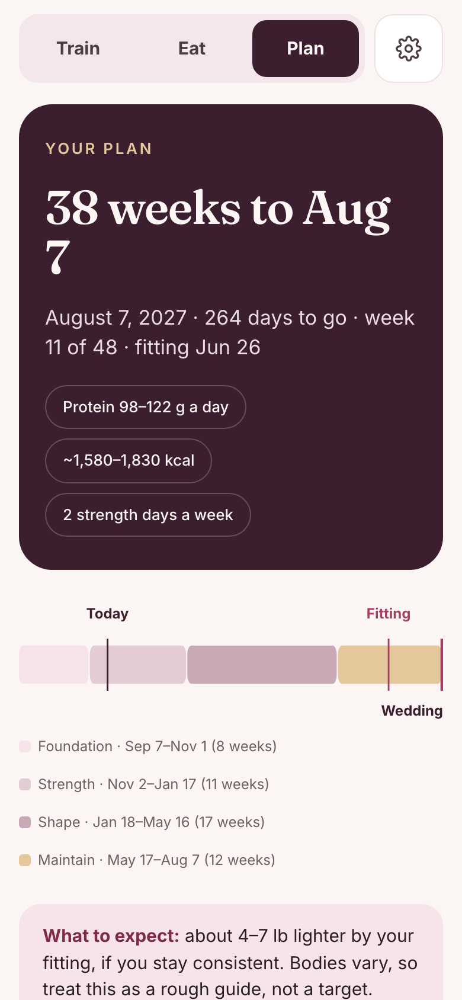

# WeddingReady

**A free web app that plans your workouts and meals for every day between now and your wedding.**

Tell it your wedding date (and your outfit fitting, if you know it). It works backwards to build a phased training and nutrition plan, fits strength sessions around the runs, classes and sports you already do, and shows you exactly what to do today.

**[weddingready.vercel.app](https://weddingready.vercel.app)** · No sign-up. Tap **Try the example plan** on the home page to look around a plan that's ten weeks in.



| Today's workout | Meals | The whole plan |
|---|---|---|
|  |  |  |

> A portfolio project. General guidance, not medical advice: no dietitian or certified trainer has reviewed the rules yet.

## What's interesting about it

**The plan is calculated, not generated.** A pure TypeScript engine (`lib/engine/`) turns a profile into a plan: phases, recovery weeks, the taper, every set and rep, calorie and protein ranges, and a rotating menu. It never reads the clock ("today" is passed in), so the same inputs always give the same plan and every rule is unit-tested. AI only handles two fuzzy inputs: estimating a meal you describe, and turning "move my run to Wednesday" into edits. Even then the app checks the answer and shows a before/after preview before anything changes.

**It schedules like a coach.** Strength days are placed by scoring every possible week against training rules:
- Two or three days are full body, never back to back, with an easy day between.
- Four or five days alternate upper and lower body, so pairs are fine, but never the same session twice running.
- Runs, rides, classes and sports are kept off strength days and the day before them.

If a week can't follow the rules as entered, it names the rule that breaks and suggests the smallest fix: moving a class, or one fewer strength day.


**It works around the dates that matter.** If you give a fitting date, the Maintain phase starts at least two weeks before it, so alterations still fit on the day. Every sixth week is a lighter recovery week, and the last ten days ease off.

**It's careful with health.** Setup asks a few safety questions, and the answers change the plan:
- Under 18s are stopped.
- Pregnancy or postpartum removes any calorie deficit.
- A history of eating disorders turns off calorie numbers and weight goals, and shows a helpline.
- A fat-loss target isn't offered at a low weight.

There are no streaks and no before-and-after photos. Deficits are capped at 0.75% of body weight a week and never go below resting needs.

**Your data never leaves your device.** There are no accounts. The plan and logs live in the browser, validated by Zod on every load, with versioned migrations and export/import. I chose this over sign-in to keep health data off a server entirely.

**The AI costs nothing to run.** Requests try Claude first. If there's no key or no credits, they fall back across Google's free Gemini models: the fast "Lite" models first, a full Flash model last. Each attempt gets 12 seconds, and a model that's busy is skipped for two minutes. Every reply is held to the same Zod schemas, typed text is passed to the model as delimited data rather than instructions, and a meal estimate whose calories don't match its protein, carbs and fat is marked low confidence. Rate limits use hashed device IDs and IPs in Upstash Redis, with a daily spend cap.

**It works offline and installs like an app.** A hand-written service worker caches the app shell and data. The manifest includes maskable icons for Android and an Apple touch icon.

**Quality bar.** 89 unit tests (engine, nutrition, guardrails, storage, AI handling and limits) and 42 Playwright end-to-end tests at phone and desktop widths. Lighthouse on mobile scores 100 for performance, accessibility, best practices and SEO on the home page, How the plan works, and the app's tabs.

## Built with

Next.js 16 (App Router) · TypeScript · Tailwind CSS 4 · Zustand · Zod · dnd-kit · Anthropic SDK · Google Gen AI SDK · Upstash Redis · Vitest · Playwright · Vercel

Food values come from USDA FoodData Central (see [Food data](#food-data)). Headings use Fraunces (SIL Open Font License).

## Running it locally

```bash
npm install            # .npmrc sets legacy-peer-deps (vitest's optional peers trip npm 10)
cp .env.example .env.local
npm run dev            # http://localhost:3000
```

It runs with no environment variables at all: AI falls back to manual entry, analytics are off, and rate limits use memory. Node 20.9+ is required (Vitest is pinned to 4.x because Vitest 5 needs Node 22).

| Command | What it does |
|---|---|
| `npm run dev` / `build` / `start` | Development server, production build, production server |
| `npm test` | Unit tests (Vitest) |
| `npm run e2e` | End-to-end tests (Playwright) at 390px and 1280px. Run `npm run build` first; it starts `next start` on port 3100 |
| `npm run lint` / `typecheck` | ESLint and TypeScript |
| `npm run foods:verify` | Rebuilds `data/foods.json` from USDA FoodData Central |
| `npm run demos:record` | Re-records the home page's demo clips from the real app (needs `next start -p 3100` and ffmpeg) |
| `npm run posthog:dashboard` | Creates a metrics dashboard in PostHog |

### Environment

All optional. See `.env.example`.

| Variable | Used for |
|---|---|
| `GEMINI_API_KEY` | Free AI through Google's Gemini free tier (key from aistudio.google.com/apikey). Google may use free-tier requests to improve its products; the privacy page says so. |
| `GEMINI_MODEL` | Overrides the first Gemini model. Default `gemini-3.5-flash-lite`, then `gemini-3.1-flash-lite`, then `gemini-3.6-flash`. |
| `ANTHROPIC_API_KEY` / `AI_MODEL` | Claude, tried first when the account has credits. Default model `claude-sonnet-5-5`. Leave the key unset otherwise, so requests don't try Claude first and fail. |
| `AI_DAILY_BUDGET_USD` | Daily AI spend cap across all users. Default `2`. Gemini's free tier counts as $0. |
| `KV_REST_API_URL` / `KV_REST_API_TOKEN` (or `UPSTASH_REDIS_REST_*`) | Rate limits and the spend cap shared across serverless instances. Needed in production. |
| `RATE_LIMIT_SECRET` | Secret for hashing device IDs and IPs in rate-limit keys |
| `NEXT_PUBLIC_POSTHOG_KEY` / `NEXT_PUBLIC_POSTHOG_HOST` | Anonymous usage analytics |

### Deploying to Vercel

1. Import the repo into Vercel. It detects Next.js.
2. Add the environment variables above for **Production**.
3. Connect **Upstash for Redis** under Storage. It sets `KV_REST_API_*`.
4. Redeploy, so the deployment picks up the variables.

## How it's organised

```
lib/engine/      The plan engine: pure functions, no clock reads, fully unit-tested
  dates.ts         Date-only math on UTC midnights (no daylight-saving bugs), Monday-first weeks
  phases.ts        Phase lengths, goal adjustments, the fitting-date shift, recovery weeks, taper
  split.ts         Weekly splits and strength-day placement around your activities
  suggest.ts       The smallest fix for a week that can't follow the rules
  workouts.ts      Exercises per equipment, sets and reps per phase, trimming to a session length
  nutrition.ts     Mifflin-St Jeor energy needs, capped deficit, macro ranges, realistic expectations
  guardrails.ts    Safety rules, enforced in the engine as well as the UI
  meals.ts         Diet and avoid-list filtering, portion scaling, daily rotation, food search
  schedule.ts      Week edits (move, add, remove, swap), validation, keeping edits when the profile changes
  plan.ts          Profile → Plan → a day's sessions and targets
lib/state/       Zod schema for saved data, versioned migrations, the Zustand store
lib/server/      AI calls (Claude and Gemini, structured output), rate limits, spend cap, Redis store
lib/example.ts   The example plan shown on the marketing pages, built by the real engine
lib/demo.ts      "Try the example plan": a plan ten weeks in, relative to today
app/page.tsx     Home page, with demo clips recorded from the real app
app/how-it-works The rules, with diagrams drawn from the engine's own output
app/(app)/       Train, Eat, Plan, Settings
app/setup/       Five-screen setup
app/api/         estimate-meal, edit-schedule
public/sw.js     Service worker
data/            Exercises, foods (generated), meal templates
```

## Decisions and defaults

- **Goal adjustments to phase lengths apply.** A tone + lose-fat plan of 48 weeks is Foundation 8 / Strength 11 / Shape 17 / Maintain 12.
- **Expectations are conservative.** The "what to expect" line shows 40–70% of a straight-line projection, stops at BMI 22, and never shows a goal weight.
- **Recovery weeks** come every sixth week after Foundation, only in the harder phases, and only on plans of 12 weeks or more.
- **Short plans.** With two to four months, Strength and Shape merge into one Build phase. With under four weeks, the plan is lighter and has no calorie deficit.
- **A fitting too early to fit** starts Maintain as early as the minimum phase lengths allow, and the Plan tab says so.
- **The final taper** runs from nine days before the wedding through the day itself.
- **Schedule changes apply from the day they're made.** Moving a session on a Wednesday leaves Monday and Tuesday as they were, with their ticks. The app keeps a short history of earlier layouts for this.
- **Days still to come are read-only.** You can look ahead at Thursday's workout, but log it on Thursday.
- **New dates re-spread the phases** over the whole plan, and the app says which phase and week you're now in.
- **Food search** lists foods that fit your diet first and labels the rest ("Not vegan"), because people log what they actually ate.
- **Exercise media** is a card with written form cues for now. Drop videos at `public/media/exercises/<id>.mp4` and set `media` in `data/exercises.json`; viewed media is cached offline.

## Food data

`data/foods.source.json` lists 163 foods. `npm run foods:verify` builds `data/foods.json` from it:

- **122 whole foods** carry a USDA FoodData Central ID and a gram weight per unit. Their values are computed from FDC's per-100 g nutrients (SR Legacy and FNDDS). The script downloads FDC's public bulk files, so no key is needed.
- **5 chain items** use the chains' published values with a dated citation.
- **36 restaurant dishes** are labelled "Restaurant estimate, varies" and aren't verified.
- **Label-dependent items** such as protein powder and oat milk are tagged "check label".

Verification found 12 values in the original hand-written plan off by more than 10%, and replaced them. For example, canned tuna went from 33 to 24 kcal per ounce, and brown rice from 216 to 248 kcal per cup.

## Known limitations

- **No expert review yet.** A registered dietitian and a certified trainer should review the energy and deficit rules, protein and fat ranges, prescriptions and progression before this is anything more than a portfolio piece.
- **Estimates can be wrong.** Restaurant values are unverified and AI estimates are approximate; both can be edited before saving.
- **Gemini's free tier** has unpublished limits, can be busy, and is restricted for apps used in the EU, UK and Switzerland. When it's unavailable, the app falls back to manual entry.
- **One device.** Data lives in one browser, so use Export in Settings for backups.
- **No exercise videos** yet, only written cues.
- **The PostHog dashboard script** hasn't been run against a live project.
