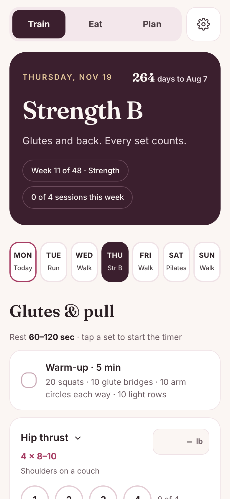
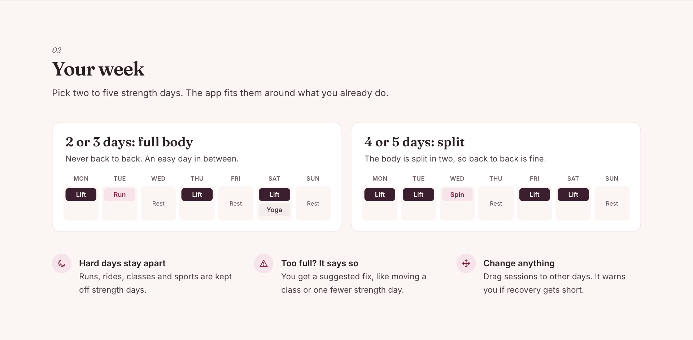
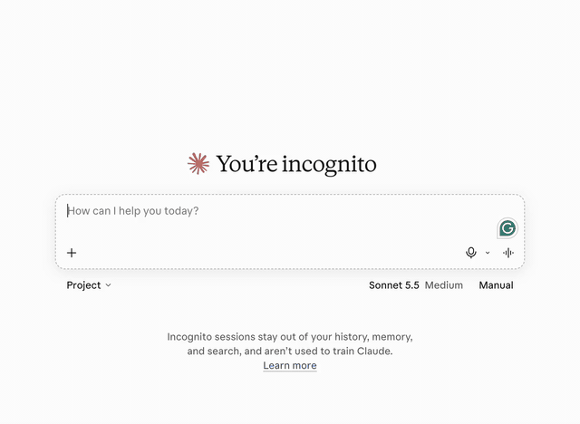

# WeddingReady

**WeddingReady helps people with a wedding in the next few months look and feel their best on the day, by working back from the wedding and fitting dates to a daily training and food plan that adjusts when life gets in the way.** Free, with no sign-up, and your data stays on your device.

Tell it your wedding date (and your outfit fitting, if you know it). It works backwards to build a phased training and nutrition plan, fits strength sessions around the runs, classes and sports you already do, and shows you exactly what to do today.

**[weddingready.vercel.app](https://weddingready.vercel.app)** · No sign-up. Tap **Try the example plan** on the home page to look around a plan that's ten weeks in.


| Today's workout | Meals | The whole plan |
|---|---|---|
|  |  |  |

> A portfolio project. General guidance, not medical advice: no dietitian or certified trainer has reviewed the rules yet.

## What's interesting about it

**The plan is calculated, not generated.** A pure TypeScript engine (`lib/engine/`) turns a profile into a plan: phases, recovery weeks, the taper, every set and rep, calorie and protein ranges, and a rotating menu. It never reads the clock ("today" is passed in), so the same inputs always give the same plan and every rule is unit-tested. AI handles the fuzzy parts, estimating a meal you describe and the coach below, and the engine checks everything it proposes.

**It schedules like a coach.** Strength days are placed by scoring every possible week against training rules:
- Two or three days are full body, never back to back, with an easy day between.
- Four days alternate upper and lower body; five days run upper, lower, push, pull, legs. Every muscle group gets two sessions a week, and back-to-back days never repeat the same main lifts.
- Runs, rides, classes and sports are kept off strength days and the day before them.

If a week can't follow the rules as entered, it names the rule that breaks and suggests the smallest fix: moving a class, or one fewer strength day.

**It can choose for beginners.** "Choose for me" in setup picks the number of strength days and any easy cardio from rules, not the model: 3 full-body days for someone new (2 with under two months or a maintain-only goal), an upper/lower split for experienced lifters chasing strength, one fewer when the week already has four or more hard sessions, and easy cardio to reach about 150 active minutes a week (a little more when losing fat), counting what they already do. The cardio shows up as its own session on the Train tab and counts toward the activity factor. It shows the reasons, and everything stays editable.

**Men and women get what the evidence supports, no more.** The training principles are the same for both sexes. The differences: women, who tend to recover faster between sets, rest about 15 seconds less on accessory exercises; men rest about 30 seconds more on main lifts; a new female lifter does incline push-ups during Foundation, then moves to the floor (with "hands on a counter if needed"); focus-area defaults differ when the outfit doesn't set them; calorie needs use the sex-specific Mifflin-St Jeor equation and floors (1,200 or 1,500 kcal). There's no menstrual-cycle periodisation: meta-analyses find only trivial, individual effects on performance.

**Age and goals change the plan where guidance says they should.** Age sets resting energy for everyone. From 65, weight loss is capped at 0.5% of body weight a week (dieting costs older adults more muscle and bone), each warm-up adds a balance drill (WHO guidance for older adults), and Choose for me stops at four strength days. A strength goal combined with Lose fat keeps the deficit at or under 500 kcal a day, since larger deficits blunt strength and muscle gains. A BMI of 30 or more sets protein from the weight at BMI 27, and suggested cardio is low-impact (walk, bike or swim). Pregnancy and postpartum remove the deficit, and the safety note carries ACOG's training advice (prop up moves done lying on your back from the second trimester, don't hold your breath, start again lighter once cleared). Session length counts the longer or shorter rest, so a 45-minute session stays 45 minutes for everyone.

**A goal weight sizes the deficit, within limits.** Setup already asks age, sex, height and weight for resting energy and activity. An optional goal weight (only with Lose fat, never with an eating-disorder history or below a healthy BMI) sets the deficit to what the goal needs by the Maintain phase, allowing for real-world adherence, but capped at 20% of what you burn and 0.75% of body weight a week, and never below resting needs. The summary checks the goal against the deficit actually set and says honestly whether it's within a safe pace.



**It works around the dates that matter.** If you give a fitting date, the Maintain phase starts at least two weeks before it, so alterations still fit on the day. Every sixth week is a lighter recovery week, and the last ten days ease off.

**It's careful with health.** Setup asks a few safety questions, and the answers change the plan:
- Under 18s are stopped.
- Pregnancy or postpartum removes any calorie deficit.
- A history of eating disorders turns off calorie numbers and weight goals, and shows a helpline.
- A fat-loss target isn't offered at a low weight.

There are no streaks and no before-and-after photos. Deficits are capped at 0.75% of body weight a week (0.5% from 65) and never go below resting needs.

**Your data never leaves your device.** There are no accounts. The plan and logs live in the browser, validated by Zod on every load, with versioned migrations and export/import. I chose this over sign-in to keep health data off a server entirely.

**A coach that acts, with guardrails.** On the Plan tab, the coach is a small agent whose tools run in the browser, on the person's own data: the server only passes one model step at a time to Gemini, with instructions it writes itself from a few plain facts (dates, strength days, equipment, food style), so the only plan details that leave the device are the ones the model asks for. Tell it "I can't train tomorrow", "my knee hurts doing lunges", "I'm in a hotel next week" or "I'm at Chipotle", and it looks at the plan with tools (the week, a day's workout, exercise alternatives, today's food), then proposes changes: move sessions for this week only or from now on, swap an exercise in every workout, use other equipment for some dates, or log a meal. Every proposal is checked by the engine (recovery rules, valid alternatives, calories that match the macros, no past days) and the result goes back to the model so it can fix problems before answering. A wrong change is worse than none, so the coach has a checklist of what each kind of request needs (which day works, the exact travel dates, what equipment a hotel gym really has, whether pain is sharp) and an `ask_question` tool with tap-able answers; anything proposed in the same breath as a question is dropped, every proposal states what it's based on, and moves are worked out by a deterministic planner (`find_best_week`, in `lib/engine/replan.ts`): the coach asks which days are off-limits and which suit, and the planner tries every arrangement of the remaining strength sessions, scores each with the same rules as setup, prefers the fewest moves (a session on a day that still works only moves if a rule needs it to), and skips one session this week rather than break a rule. A lasting change ("from now on") is worked out on the usual week, never a one-off, and starts next Monday; the rest of this week gets a matching change around what's already done, so nothing is repeated or undone. The model only describes the result. Meals and equipment changes must be grounded in words the person actually said. If the model describes a change without proposing it, the loop points that out once. The app shows a before/after preview, and nothing changes until you tap Apply; "this week only" changes end on Sunday, and past days never change. The coach never sees weight, height, age or health answers, never changes calorie targets, and shows no food numbers to anyone who chose none.

**Setup from one sentence.** "Describe your plans" turns "wedding Oct 16 next year, I run Tuesdays, Pilates Saturdays, dumbbells at home, vegetarian" into the setup form with one free Gemini call. The schema has no fields for weight, height, age or health, and the code checks every value: dates in the future with the fitting before the wedding, a day the person actually wrote next to its month (so "in May" is never guessed as May 1), 2–5 strength days. It lists everything it filled and anything it couldn't use, so the person checks it on each step.

**Plans move between chat and the app.** A plan code (`wr1.…`, the training details only, base64url JSON validated with Zod) carries a plan both ways without accounts: the MCP tool returns a link that opens setup with the plan filled in (the code rides after the `#`, so it never reaches the server), and the app's "Copy for Claude" hands the plan to an assistant. Workouts go to Apple Calendar, Google Calendar or Outlook as a subscription built from the plan code (times converted to UTC for the person's time zone, across daylight saving), or to any calendar as an `.ics` file made on the device, and the `calendar_events` tool gives assistants dated events to add with their own calendar connector.

**The AI costs nothing to run.** Requests try Claude first. If there's no key or no credits, they fall back across Google's free Gemini models: the fast "Lite" models first, a full Flash model last. Each attempt gets 12 seconds, and a model that's busy is skipped for two minutes. Every reply is held to the same Zod schemas, typed text is passed to the model as delimited data rather than instructions, and a meal estimate whose calories don't match its protein, carbs and fat is marked low confidence. Rate limits use hashed device IDs and IPs in Upstash Redis, with a daily spend cap, a daily cap on free-model calls across every AI route (so a busy day can't use up the free quota for everyone), and AI routes refuse requests that other websites send.

**AI assistants can use it.** WeddingReady is also a remote MCP server at `https://weddingready.vercel.app/api/mcp`, so Claude (as a custom connector) or any MCP client can build a plan, get a day's workout, add sessions to a calendar, place strength days, set calorie and protein targets, and look up foods. The tools call the same engine as the app, apply the same safety rules, are read-only and stateless, and store nothing about the caller beyond an anonymous per-tool count. See [/agents](https://weddingready.vercel.app/agents).



**It works offline and installs like an app.** A hand-written service worker caches the app shell and data. The manifest includes maskable icons for Android and an Apple touch icon.

**The coach is tested on behaviour.** `npm run coach:eval` runs 15 realistic requests through the real coach on the free Gemini tier and checks what it does, not what it says: it asks when the day, dates, equipment or kind of pain is missing; proposes when they aren't; never proposes a week that breaks the rules; stops on sharp pain; shows no food numbers to someone who chose none; never claims a change is already made; and isn't talked out of its rules. The latest run passed 30 of 30 (two runs each). For assistants, `experiment/` is a hand-run kit of 13 questions with engine-computed answers (energy, protein, scheduling, safety) to compare assistants with and without the WeddingReady connector.

**Quality bar.** 167 unit tests (engine, nutrition, guardrails, storage, the coach's tools and loop, AI handling and limits) and 57 Playwright end-to-end tests at phone and desktop widths. Lighthouse on mobile scores 100 for performance, accessibility, best practices and SEO on the home page, How the plan works, and the app's tabs.

## Built with

Next.js 16 (App Router) · TypeScript · Tailwind CSS 4 · Zustand · Zod · dnd-kit · Anthropic SDK · Google Gen AI SDK · Upstash Redis · Vitest · Playwright · Vercel

Food values come from USDA FoodData Central (see [Food data](#food-data)). Headings use Fraunces (SIL Open Font License).

## Running it locally

```bash
npm install            # .npmrc sets legacy-peer-deps (vitest's optional peers trip npm 10)
cp .env.example .env.local
npm run dev            # http://localhost:3000
```

It runs with no environment variables at all: AI falls back to manual entry, analytics are off, and rate limits use memory. Node 20.9+ is required (Vitest is pinned to 4.x because Vitest 5 needs Node 22).

| Command | What it does |
|---|---|
| `npm run dev` / `build` / `start` | Development server, production build, production server |
| `npm test` | Unit tests (Vitest) |
| `npm run plan:sweep` | Checks plan invariants across 152,744 sampled profiles (sex, age, size, goal combinations, experience, days, equipment, timelines) |
| `npm run coach:eval` | The coach's behaviour suite against free Gemini (needs `GEMINI_API_KEY`; `-- --runs 3`, `-- --only pain`) |
| `npm run experiment:generate` / `experiment:summarize` | The assistant experiment: write the private answer key; score `experiment/results.csv` (see `experiment/README.md`) |
| `npm run e2e` | End-to-end tests (Playwright) at 390px and 1280px. Run `npm run build` first; it starts `next start` on port 3100 |
| `npm run lint` / `typecheck` | ESLint and TypeScript |
| `npm run foods:verify` | Rebuilds `data/foods.json` from USDA FoodData Central |
| `npm run demos:record` | Re-records the home page's demo clips from the real app (needs `next start -p 3100` and ffmpeg) |
| `npm run posthog:dashboard` | Creates the metrics dashboard in PostHog: activation, day-1 action, weekly use, traffic sources, the funnel by source (visit → setup → first workout → back in week 2), week-2 return, and the “how did you hear” answers |

### Environment

All optional. See `.env.example`.

| Variable | Used for |
|---|---|
| `GEMINI_API_KEY` | Free AI through Google's Gemini free tier (key from aistudio.google.com/apikey). Google may use free-tier requests to improve its products; the privacy page says so. |
| `GEMINI_MODEL` | Overrides the first Gemini model for meal estimates. Default `gemini-3.5-flash-lite`, then `gemini-3.1-flash-lite`, then `gemini-3.6-flash`. |
| `COACH_MODEL` | Overrides the coach's first model. Default `gemini-3.1-flash-lite` (fastest at tool use in testing), with the same fallbacks. The coach only uses the free Gemini tier, so it costs nothing even when an Anthropic key is set. |
| `ANTHROPIC_API_KEY` / `AI_MODEL` | Claude, tried first when the account has credits. Default model `claude-sonnet-5-5`. Leave the key unset otherwise, so requests don't try Claude first and fail. |
| `AI_DAILY_BUDGET_USD` | Daily AI spend cap across all users. Default `2`. Gemini's free tier counts as $0. |
| `KV_REST_API_URL` / `KV_REST_API_TOKEN` (or `UPSTASH_REDIS_REST_*`) | Rate limits and the spend cap shared across serverless instances. Needed in production. |
| `GEMINI_DAILY_CALLS` | Free-model calls a day across all AI routes and users. Default `2000`. |
| `RATE_LIMIT_SECRET` | Secret for hashing device IDs and IPs in rate-limit keys |
| `NEXT_PUBLIC_POSTHOG_KEY` / `NEXT_PUBLIC_POSTHOG_HOST` | Anonymous usage analytics: cookieless, no autocapture or recordings. Funnel events carry first-touch source (UTM tags like `?utm_source=linkedin&utm_medium=social`, or the referring domain), and setup ends with an optional “How did you hear about us?” |

### Deploying to Vercel

1. Import the repo into Vercel. It detects Next.js.
2. Add the environment variables above for **Production**.
3. Connect **Upstash for Redis** under Storage. It sets `KV_REST_API_*`.
4. Redeploy, so the deployment picks up the variables.

## How it's organised

```
lib/engine/      The plan engine: pure functions, no clock reads, fully unit-tested
  dates.ts         Date-only math on UTC midnights (no daylight-saving bugs), Monday-first weeks
  phases.ts        Phase lengths, goal adjustments, the fitting-date shift, recovery weeks, taper
  split.ts         Weekly splits and strength-day placement around your activities
  suggest.ts       The smallest fix for a week that can't follow the rules
  workouts.ts      Exercises per equipment, sets and reps per phase, trimming to a session length
  nutrition.ts     Mifflin-St Jeor energy needs, capped deficit, macro ranges, realistic expectations
  guardrails.ts    Safety rules, enforced in the engine as well as the UI
  meals.ts         Diet and avoid-list filtering, portion scaling, daily rotation, food search
  schedule.ts      Week edits (move, add, remove, swap), validation, keeping edits when the profile changes
  plan.ts          Profile → Plan → a day's sessions and targets
lib/state/       Zod schema for saved data, versioned migrations, the Zustand store
lib/server/      AI calls (Claude and Gemini, structured output), rate limits, spend cap, Redis store
  mcp/             The MCP server for AI assistants: six read-only tools over the engine
  coach.ts         One coach step on free Gemini; the whole loop server-side for tests and the eval
  describe.ts      "Describe your plans": one free Gemini call, checked in lib/describe.ts
lib/coach/       The coach's tools, instructions and agent loop, run in the browser
lib/describe.ts  Reading a setup description: value checks, filling the draft, listing what was filled
lib/handoff.ts   Plan codes: a plan's training details in a link or a paste
lib/calendar.ts  Sessions as calendar events and .ics files
lib/example.ts   The example plan shown on the marketing pages, built by the real engine
lib/demo.ts      "Try the example plan": a plan ten weeks in, relative to today
app/page.tsx     Home page, with demo clips recorded from the real app
app/how-it-works The rules, with diagrams drawn from the engine's own output
app/(app)/       Train, Eat, Plan, Settings
app/setup/       Five-screen setup
app/api/         estimate-meal, coach (one step), describe-setup, mcp, ics
public/sw.js     Service worker
data/            Exercises, foods (generated), meal templates
```

## Decisions and defaults

- **Goal adjustments to phase lengths apply.** A tone + lose-fat plan of 48 weeks is Foundation 8 / Strength 11 / Shape 17 / Maintain 12.
- **Expectations are conservative.** The "what to expect" line shows 40–70% of a straight-line projection, stops at BMI 22, and never shows a weight below a healthy BMI. A goal weight, if given, is checked against the same limits.
- **Recovery weeks** come every sixth week after Foundation, only in the harder phases, and only on plans of 12 weeks or more.
- **Short plans.** With two to four months, Strength and Shape merge into one Build phase. With under four weeks, the plan is lighter and has no calorie deficit.
- **A fitting too early to fit** starts Maintain as early as the minimum phase lengths allow, and the Plan tab says so.
- **The final taper** runs from nine days before the wedding through the day itself.
- **Schedule changes apply from the day they're made.** Moving a session on a Wednesday leaves Monday and Tuesday as they were, with their ticks. The app keeps a short history of earlier layouts for this.
- **Days still to come are read-only.** You can look ahead at Thursday's workout, but log it on Thursday.
- **New dates re-spread the phases** over the whole plan, and the app says which phase and week you're now in.
- **Food search** lists foods that fit your diet first and labels the rest ("Not vegan"), because people log what they actually ate.
- **Exercise media** is a card with written form cues for now. Drop videos at `public/media/exercises/<id>.mp4` and set `media` in `data/exercises.json`; viewed media is cached offline.

## Food data

`data/foods.source.json` lists 163 foods. `npm run foods:verify` builds `data/foods.json` from it:

- **122 whole foods** carry a USDA FoodData Central ID and a gram weight per unit. Their values are computed from FDC's per-100 g nutrients (SR Legacy and FNDDS). The script downloads FDC's public bulk files, so no key is needed.
- **5 chain items** use the chains' published values with a dated citation.
- **36 restaurant dishes** are labelled "Restaurant estimate, varies" and aren't verified.
- **Label-dependent items** such as protein powder and oat milk are tagged "check label".

Verification found 12 values in the original hand-written plan off by more than 10%, and replaced them. For example, canned tuna went from 33 to 24 kcal per ounce, and brown rice from 216 to 248 kcal per cup.

## Known limitations

- **No expert review yet.** A registered dietitian and a certified trainer should review the energy and deficit rules, protein and fat ranges, prescriptions and progression before this is anything more than a portfolio piece.
- **Estimates can be wrong.** Restaurant values are unverified and AI estimates are approximate; both can be edited before saving.
- **Gemini's free tier** has unpublished limits, can be busy, and is restricted for apps used in the EU, UK and Switzerland. When it's unavailable, the app falls back to manual entry.
- **One device.** Data lives in one browser, so use Export in Settings for backups.
- **No exercise videos** yet, only written cues.
- **The PostHog dashboard script** hasn't been run against a live project.
